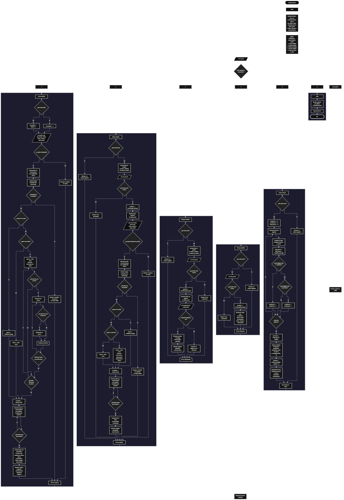

Este proyecto, llamado <b>analizador json</b>, fue desarrollado en <b>python</b> como un ejercicio práctico para fortalecer la lógica de programación mediante la creación de un sistema de gestión y análisis de archivos JSON desde la consola. El programa cuenta con un menú principal de seis opciones que permite <b>crear, editar, eliminar, buscar y listar análisis de archivos JSON</b>, además de consultar información relacionada con las claves encontradas en cada archivo. Cada registro almacena datos como el título, la ruta del archivo, la cantidad de claves, los nombres de las claves, la fecha, el estado y las observaciones, utilizando ocho listas paralelas para mantener organizada la información durante la ejecución. Durante su desarrollo se aplicaron conceptos fundamentales de programación, como variables, listas, estructuras condicionales, ciclos repetitivos, estructuras de selección, manejo de archivos, procesamiento de datos JSON, excepciones y operaciones de búsqueda y modificación de registros. Este proyecto permite poner en práctica los conocimientos adquiridos en Python y sirve como base para desarrollar herramientas de análisis de archivos estructurados y sistemas de gestión más avanzados.

<h2 align="center">⚙️ Funcionamiento del menú principal</h2>

### ➕ Crear análisis

La opción <b>1) crear análisis</b> permite registrar un nuevo análisis de un archivo JSON. Antes de generar el registro, el programa comprueba si la lista <b>ids</b> está vacía. Si no existen registros, asigna el identificador <b>1</b> mediante la variable <b>id_analisis</b>; de lo contrario, obtiene el siguiente identificador sumando uno al último valor almacenado en la lista. Después, solicita el <b>título, la ruta del archivo JSON, la fecha, el estado y la observación</b>. A continuación, utiliza <b>os.path.exists(ruta)</b> para comprobar si el archivo existe. Si la ruta es válida, abre el archivo en modo lectura con codificación UTF-8 y utiliza <b>json.load(archivo)</b> para interpretar su contenido. Cuando el contenido es un diccionario, obtiene las claves del objeto principal. Si es una lista, recorre sus elementos y recopila las claves de los diccionarios contenidos directamente en ella, evitando repetir nombres de claves. Si el contenido corresponde a otro tipo de dato JSON, establece una lista vacía de claves. Posteriormente, construye una cadena con los nombres encontrados, calcula su cantidad y almacena la información en las ocho listas paralelas. Finalmente, muestra los mensajes <b>"archivo analizado correctamente."</b> y el identificador asignado. Si el archivo no existe, presenta el mensaje <b>"el archivo no existe."</b>; si ocurre una excepción durante la lectura o el procesamiento, muestra <b>"el archivo no contiene un json válido."</b>.

### ✏️ Editar análisis

La opción <b>2) editar análisis</b> permite modificar la información de un análisis registrado. Primero, el programa comprueba si existen registros almacenados en la lista <b>ids</b>. Si no hay registros, muestra el mensaje <b>"no existen registros."</b>. En caso contrario, presenta una lista con el identificador, el título, la cantidad de claves y el estado de cada análisis. Después, solicita el identificador mediante la variable <b>id_buscar</b> y comprueba si se encuentra en la lista <b>ids</b>. Si existe, utiliza <b>ids.index(id_buscar)</b> para obtener la posición del registro y muestra sus datos actuales. A continuación, solicita el nuevo título, la nueva ruta del archivo JSON, la nueva fecha, el nuevo estado y la nueva observación. El programa comprueba que la nueva ruta exista y vuelve a leer el archivo mediante <b>json.load()</b>. Después, repite el procedimiento de identificación de claves utilizado durante la creación del análisis, calcula la nueva cantidad y reconstruye la cadena de claves. Si el procesamiento se completa correctamente, actualiza los datos correspondientes en las ocho listas y muestra el mensaje <b>"registro actualizado correctamente."</b>. Si la ruta no existe, informa mediante <b>"el archivo no existe."</b>; si ocurre una excepción durante el procesamiento, muestra <b>"el archivo no contiene un json válido."</b>. Si el identificador no corresponde a ningún registro, presenta el mensaje <b>"id no encontrada."</b>.

### 🗑️ Eliminar análisis

La opción <b>3) eliminar análisis</b> permite eliminar un registro de la lista de análisis. Antes de comenzar, el programa comprueba si existen registros almacenados. Si la lista está vacía, muestra el mensaje <b>"no existen registros."</b>. Si hay análisis disponibles, presenta una lista con el identificador, el título, la cantidad de claves y el estado de cada registro. Después, solicita el identificador que se desea eliminar y comprueba si existe en la lista <b>ids</b>. Cuando encuentra el registro, obtiene su posición mediante <b>ids.index(id_buscar)</b> y muestra el identificador, el título y la ruta del archivo. A continuación, solicita confirmación mediante la pregunta <b>"¿desea eliminar este registro? (s/n):"</b>. Si la respuesta convertida a mayúsculas mediante <b>respuesta.upper()</b> es igual a <b>"S"</b>, utiliza el método <b>pop(posicion)</b> para eliminar los datos correspondientes en las ocho listas: identificadores, títulos, rutas, cantidad de claves, claves encontradas, fechas, estados y observaciones. Finalmente, muestra el mensaje <b>"registro eliminado correctamente."</b>. Si la respuesta no es <b>"S"</b>, presenta <b>"el registro no fue eliminado."</b>. Si el identificador no existe, informa mediante <b>"id no encontrada."</b>. Esta operación mantiene sincronizadas las listas al eliminar la misma posición en cada una de ellas.

### 🔎 Buscar análisis

La opción <b>4) buscar análisis</b> permite localizar un registro mediante su identificador. Primero, el programa comprueba si existen análisis almacenados. Si no hay registros, muestra el mensaje <b>"no existen registros."</b>. En caso contrario, solicita el identificador que se desea buscar mediante la variable <b>id_buscar</b>. Si el identificador se encuentra en la lista <b>ids</b>, obtiene su posición con <b>ids.index(id_buscar)</b> y muestra la información completa del análisis: identificador, título, ruta del archivo, cantidad de claves, nombres de las claves encontradas, fecha, estado y observación. La información se recupera de las ocho listas utilizando la misma posición, lo que permite presentar los datos relacionados con el registro seleccionado. Si el identificador no se encuentra, el programa muestra el mensaje <b>"id no encontrada."</b>. Esta función facilita consultar los resultados de un análisis específico sin necesidad de recorrer manualmente todos los registros.

### 📋 Lista de datos

La opción <b>5) lista de datos</b> permite visualizar los análisis registrados y obtener estadísticas generales. Antes de iniciar, el programa comprueba si la lista <b>ids</b> está vacía. Si no existen registros, muestra el mensaje <b>"no existen registros."</b>. Si hay información disponible, inicializa las variables <b>analizados</b>, <b>pendientes</b> y <b>total_claves</b> en cero. Después, utiliza un ciclo <b>for</b> para recorrer las listas y mostrar el identificador, el título, la cantidad de claves y el estado de cada análisis. Durante el recorrido, acumula la cantidad total de claves y comprueba el estado de cada registro mediante <b>estados[i].lower()</b>. Si el estado coincide con <b>"analizado"</b>, incrementa el contador de análisis completados; si coincide con <b>"pendiente"</b>, incrementa el contador de análisis pendientes. Al finalizar, calcula el promedio de claves por archivo mediante la operación <b>total_claves / len(ids)</b> y redondea el resultado a dos decimales utilizando <b>round(promedio, 2)</b>. Después, presenta la cantidad de archivos registrados, los archivos analizados, los pendientes, el total de claves y el promedio de claves por archivo. Finalmente, utiliza <b>random.randint(0, len(ids) - 1)</b> para seleccionar aleatoriamente un registro y mostrar su título, ruta, cantidad de claves y nombres de las claves encontradas. Esta opción permite consultar tanto el resumen general de los análisis como un registro seleccionado al azar.

### 🚪 Salir del menú principal

La opción <b>6) salir</b> permite finalizar la ejecución del programa. Cuando el usuario selecciona esta opción, el programa muestra el mensaje <b>"gracias por utilizar el analizador json."</b> y ejecuta la instrucción <b>break</b> para interrumpir el ciclo principal <b>while True</b>. De esta manera, el usuario puede realizar diferentes operaciones de gestión y análisis de archivos JSON mientras lo necesite y terminar la ejecución cuando seleccione la opción de salida.

<h2 align="center">🧠 Temas aplicados en el proyecto</h2>

### 📦 Variables

En este proyecto se utilizan variables para almacenar temporalmente los datos introducidos por el usuario, identificar los registros que se desean editar, eliminar o consultar, procesar el contenido de los archivos JSON y calcular las estadísticas de los análisis registrados. Cada variable cumple una función específica dentro del programa y permite organizar las operaciones realizadas por las diferentes opciones del menú principal.

🔢 **Opcion:** Almacena la opción seleccionada por el usuario en el menú principal.

🆔 **Id_analisis:** Almacena el identificador asignado al nuevo análisis.

🔎 **Id_buscar:** Almacena el identificador introducido para localizar un registro.

📍 **Posicion:** Indica la posición del registro seleccionado dentro de las listas.

📄 **Titulo, ruta, fecha, estado y observacion:** Almacenan temporalmente los datos introducidos al crear un análisis.

📝 **Datos:** Almacena el contenido interpretado del archivo JSON mediante la función `json.load()`.

🔑 **Claves:** Almacena los nombres de las claves identificadas en el contenido JSON.

📋 **Resultado:** Construye una cadena con los nombres de las claves encontradas, separados por espacios.

📊 **Analizados, pendientes y total_claves:** Controlan los contadores utilizados para calcular las estadísticas generales.

📈 **Promedio:** Almacena el promedio de claves por archivo antes de mostrarlo redondeado a dos decimales.

🎲 **I:** Funciona como índice en los ciclos utilizados para recorrer los registros y sus elementos.

### 🗃️ Listas

En este proyecto se utilizan ocho listas paralelas para almacenar la información de los análisis registrados. Cada lista contiene un tipo de dato específico y utiliza el mismo índice para relacionar los datos de un mismo registro. Por ejemplo, la información del análisis situado en la posición <b>0</b> se encuentra distribuida entre <b>ids[0], titulos[0], rutas[0], cantidad_claves[0], claves_json[0], fechas[0], estados[0] y observaciones[0]</b>. Esta organización permite recorrer, buscar, modificar y eliminar registros manteniendo la relación entre sus datos durante la ejecución del programa.

🆔 **Ids:** Almacena los identificadores de los análisis registrados.

📝 **Titulos:** Almacena los títulos asignados a los análisis.

📂 **Rutas:** Almacena las rutas de los archivos JSON analizados.

🔢 **Cantidad_claves:** Almacena la cantidad de claves identificadas en cada archivo.

🔑 **Claves_json:** Almacena los nombres de las claves encontradas, concatenados en una cadena.

📅 **Fechas:** Almacena las fechas introducidas para los análisis.

📌 **Estados:** Almacena el estado indicado para cada análisis.

📄 **Observaciones:** Almacena las observaciones relacionadas con cada registro.

### 🔀 Estructuras condicionales

En este proyecto se utilizan las estructuras <b>if</b>, <b>elif</b> y <b>else</b> para controlar las opciones del menú y determinar qué instrucciones deben ejecutarse. También permiten comprobar si existen registros antes de realizar determinadas operaciones, verificar si un identificador está almacenado, comprobar la existencia de una ruta, distinguir entre diccionarios, listas y otros tipos de datos JSON, y determinar si se debe eliminar un registro. Durante el análisis de los archivos, estas condiciones permiten aplicar un procedimiento diferente según la estructura del contenido. Asimismo, se utilizan comparaciones para clasificar los estados y calcular las estadísticas correspondientes.

### 🔄 Estructuras repetitivas

En este proyecto se utilizan los ciclos <b>while</b> y <b>for</b>. El ciclo <b>while True</b> mantiene activo el menú principal hasta que el usuario selecciona la opción de salida, que ejecuta la instrucción <b>break</b>. Los ciclos <b>for</b> permiten recorrer los registros almacenados, examinar los elementos de las listas JSON y obtener las claves de los diccionarios encontrados. También se utilizan para construir la cadena que contiene los nombres de las claves y para calcular las estadísticas de todos los análisis registrados. Estas estructuras permiten procesar conjuntos de datos sin necesidad de repetir manualmente las mismas instrucciones.

### 🎯 Estructura de selección

El menú principal utiliza una estructura condicional compuesta por <b>if</b>, <b>elif</b> y <b>else</b> para seleccionar la operación que corresponde al valor almacenado en la variable <b>opcion</b>. Las seis opciones permiten crear, editar, eliminar y buscar análisis, consultar la lista de datos o salir del programa. Cuando el valor introducido no coincide con ninguna opción disponible, se ejecuta el bloque <b>else</b>, que muestra el mensaje <b>"opción no válida."</b>. Esta organización permite centralizar las operaciones disponibles y facilitar la navegación por el sistema.

### 📂 Manejo de archivos

El proyecto utiliza la función <b>open()</b> para abrir los archivos JSON en modo lectura mediante el parámetro <b>"r"</b> y la codificación <b>"utf-8"</b>. La instrucción <b>with open(ruta, "r", encoding="utf-8") as archivo</b> permite gestionar la apertura y el cierre del archivo dentro de un bloque controlado. Antes de intentar leerlo, el programa utiliza <b>os.path.exists()</b> para comprobar que la ruta indicada exista. Esta operación permite acceder al contenido del archivo sin modificarlo y preparar sus datos para el análisis.

### 🧾 Procesamiento de archivos JSON

El módulo <b>json</b> se utiliza mediante la función <b>json.load()</b>, que interpreta el contenido de un archivo y lo convierte en una estructura de datos de Python. El programa comprueba si el resultado es un diccionario mediante <b>isinstance(datos, dict)</b> o una lista mediante <b>isinstance(datos, list)</b>. Para los diccionarios, obtiene las claves del objeto principal. Para las listas, recorre los elementos y recopila las claves de los diccionarios que contiene directamente, evitando duplicados mediante la condición <b>if clave not in claves</b>. Si el contenido es de otro tipo, utiliza una lista vacía. Finalmente, construye una cadena con los nombres de las claves y calcula su cantidad. El programa no recorre recursivamente los objetos anidados ni analiza los valores de las propiedades.

### ⚠️ Manejo de excepciones

En las operaciones de creación y edición se utilizan los bloques <b>try</b> y <b>except</b> para controlar los errores que puedan ocurrir durante la apertura, lectura o interpretación del archivo JSON, así como durante el procesamiento posterior de sus datos. Si se produce una excepción dentro de estos bloques, el programa muestra el mensaje <b>"el archivo no contiene un json válido."</b>. Aunque este mensaje informa de que el procesamiento no se completó, el bloque <b>except</b> actual captura cualquier excepción, por lo que el error también podría deberse a otra causa distinta de un formato JSON inválido.

### 📊 Estadísticas

La opción de lista de datos incorpora cálculos para resumir la información de los análisis registrados. La variable <b>analizados</b> cuenta los registros cuyo estado coincide con <b>"analizado"</b>, mientras que <b>pendientes</b> cuenta los que coinciden con <b>"pendiente"</b>, sin distinguir mayúsculas de minúsculas. La variable <b>total_claves</b> acumula las cantidades de claves de todos los registros. Posteriormente, el programa calcula el promedio dividiendo el total de claves entre el número de análisis registrados y utiliza <b>round(promedio, 2)</b> para redondearlo a dos decimales. Estas operaciones permiten conocer el volumen de archivos analizados, el estado de los registros y la cantidad promedio de claves identificadas por archivo.

### 🎲 Selección aleatoria

El módulo <b>random</b> permite seleccionar aleatoriamente uno de los análisis registrados mediante la función <b>random.randint(0, len(ids) - 1)</b>. El resultado se almacena en la variable <b>posicion</b> y se utiliza como índice para consultar los datos correspondientes en las listas paralelas. Esta selección se realiza al finalizar la opción de lista de datos, después de comprobar que existen registros, y muestra el título, la ruta, la cantidad de claves y la cadena con los nombres de las claves del archivo seleccionado.

### 🔄 Administración de registros

El programa administra los registros mediante operaciones que permiten agregar nuevos análisis con <b>append()</b>, localizar registros mediante <b>index()</b>, modificar sus datos utilizando la posición encontrada y eliminar registros mediante <b>pop()</b>. Debido a que los datos están distribuidos en ocho listas paralelas, cada operación de actualización o eliminación debe aplicarse a todas las listas correspondientes para conservar la relación entre los datos. Los identificadores se generan a partir del último valor almacenado en <b>ids</b>, mientras que la información de los archivos y las estadísticas se mantiene en memoria durante la ejecución.

<h2 align="center">¿Cómo se implementaron las operaciones crud en el proyecto?</h2>

Las operaciones <b>crud</b> se implementaron mediante las opciones del menú principal, permitiendo administrar los análisis de archivos JSON. La operación <b>crear</b> corresponde a <b>crear análisis</b>, donde se registra un archivo y se almacenan los datos de su análisis; <b>leer</b> se realiza mediante las opciones <b>buscar análisis y lista de datos</b>, que permiten consultar los registros y sus resultados; <b>actualizar</b> corresponde a <b>editar análisis</b>, donde se modifican los datos y se procesa nuevamente el archivo indicado; y <b>eliminar</b> se realiza mediante la opción <b>eliminar análisis</b>, que permite borrar un registro después de solicitar confirmación. Estas operaciones utilizan listas, condicionales, ciclos, búsqueda por identificador y procesamiento de archivos para administrar la información temporalmente durante la ejecución del programa.

<h2 align="center">Diagrama de flujo del proyecto</h2>

<h2 align="center">🛡️ Validaciones del programa</h2>

### 📭 No existen registros

Esta comprobación se utiliza en las opciones de <b>editar, eliminar, buscar y lista de datos</b>. El programa verifica si la lista <b>ids</b> está vacía mediante la condición <b>len(ids) == 0</b>. Si no existen registros, muestra el mensaje <b>"no existen registros."</b> y evita continuar con las operaciones que necesitan información almacenada. Esta comprobación permite controlar el comportamiento del menú cuando todavía no se ha creado ningún análisis o cuando todos los registros han sido eliminados.

### 📂 Archivo inexistente

Esta comprobación se utiliza durante la creación y edición de análisis. El programa utiliza <b>os.path.exists(ruta)</b> para determinar si existe un archivo en la ruta introducida. Durante la edición, se realiza la misma comprobación con la nueva ruta almacenada en la variable <b>nueva_ruta</b>. Si el archivo no existe, el programa muestra el mensaje <b>"el archivo no existe."</b> y no incorpora los nuevos datos a las listas. Esta comprobación verifica la existencia de la ruta, pero no garantiza por sí sola que el archivo tenga un contenido JSON válido.

### ⚠️ Error durante el procesamiento del JSON

Esta comprobación se realiza mediante los bloques <b>try</b> y <b>except</b> de las opciones de creación y edición. El programa intenta abrir el archivo, interpretar su contenido con <b>json.load()</b> y procesar las claves encontradas. Si ocurre una excepción durante estas operaciones, muestra el mensaje <b>"el archivo no contiene un json válido."</b>. El mensaje es general porque el bloque actual captura cualquier excepción producida dentro de la sección protegida y no identifica específicamente el tipo de error.

### 🔎 Identificador no encontrado

Esta comprobación se utiliza durante las operaciones de edición, eliminación y búsqueda. Después de solicitar un identificador, el programa verifica si el valor introducido está presente en la lista <b>ids</b>. Si existe, obtiene la posición del registro mediante <b>ids.index(id_buscar)</b> y continúa con la operación seleccionada. Si no existe, muestra el mensaje <b>"id no encontrada."</b>. Esta comprobación evita que el programa modifique o elimine un registro que no se encuentra almacenado.

### 🗑️ Confirmación de eliminación

Antes de eliminar un registro, el programa solicita una confirmación mediante la variable <b>respuesta</b>. La condición <b>respuesta.upper() == "S"</b> permite aceptar la letra s tanto en mayúscula como en minúscula. Si la condición se cumple, elimina el registro de las ocho listas paralelas. Si la respuesta es cualquier otro valor, no elimina el registro y muestra el mensaje <b>"el registro no fue eliminado."</b>. Esta comprobación permite confirmar la operación antes de borrar los datos almacenados.

### 📌 Clasificación de estados

En la opción de lista de datos, el programa utiliza la función <b>lower()</b> para comparar los estados sin distinguir entre mayúsculas y minúsculas. Los registros cuyo estado coincide con <b>"analizado"</b> incrementan el contador de archivos analizados, mientras que aquellos cuyo estado coincide con <b>"pendiente"</b> incrementan el contador de archivos pendientes. Aunque al crear un registro se solicita uno de estos dos estados, el código no incluye una validación que impida introducir otros valores. Por ello, los estados diferentes de las dos categorías reconocidas no se incluyen en ninguno de esos contadores.

### 🔢 Entrada de identificadores

Durante las operaciones de edición, eliminación y búsqueda, el programa convierte el valor introducido mediante <b>int(input(...))</b>. Esto permite utilizar identificadores numéricos para localizar los registros. Sin embargo, el código no incorpora un manejo específico para entradas que no puedan convertirse en números enteros. Si el usuario introduce texto u otro valor no válido para esta conversión, puede producirse una excepción que interrumpa la ejecución del programa.

### 💾 Almacenamiento temporal

Los registros se almacenan en las ocho listas creadas al comienzo del programa. Aunque el módulo <b>json</b> permite leer el contenido de los archivos analizados, el programa no utiliza <b>json.dump()</b> ni otra operación de escritura para guardar los registros de gestión en un archivo propio. Por esta razón, los títulos, identificadores, estados, fechas, observaciones y resultados almacenados en las listas se conservan únicamente mientras el programa permanece en ejecución. Al finalizarlo, estos registros se pierden.

<h2 align="center">🎯 Objetivo del proyecto</h2>

El objetivo principal de este proyecto es fortalecer la <b>lógica de programación</b> mediante el desarrollo de un sistema de gestión y análisis de archivos JSON en <b>python</b>. A través de su construcción se busca aplicar los conocimientos adquiridos sobre variables, listas, estructuras condicionales, ciclos repetitivos, estructuras de selección, manejo de archivos, procesamiento de datos estructurados y excepciones. Además, el proyecto permite comprender cómo interpretar archivos JSON, identificar sus claves, calcular estadísticas y administrar registros mediante operaciones de creación, consulta, actualización y eliminación. De esta manera, se establece una base para desarrollar herramientas de análisis de datos y sistemas de gestión más completos utilizando Python y otras tecnologías.

